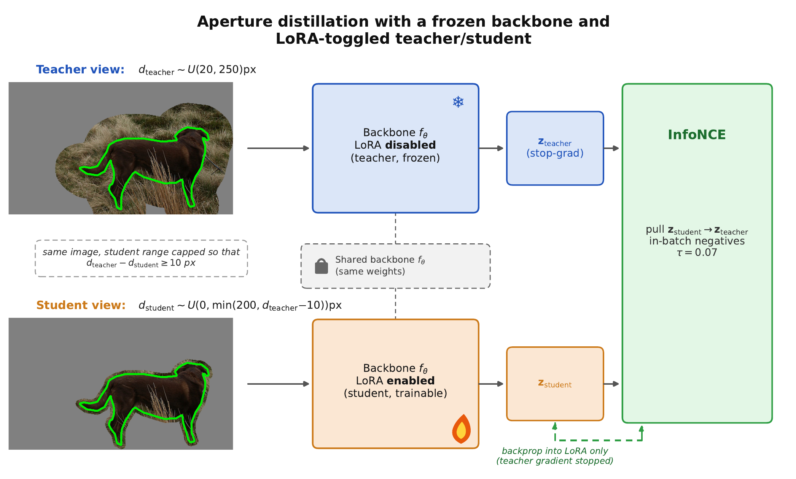

# KAP: Keyhole Aperture Probe

Code for **"Object-Only Is Not Context-Free: A Counterfactual Diagnostic for
Context Removal in Object Retrieval"** (Boaz Meivar, Shai Avidan; WACV 2027).



KAP measures how much a mask-pooled object descriptor depends on the scene
around the object. Each query object is encoded at several *apertures*: the
object mask dilated by `d` pixels with everything outside filled (`d = 0` is
object-only), plus the full image. Every condition is pooled with the same,
undilated object mask, so only the visible context changes. The headline
number is **retention** `d0/full`, the object-only R@1 as a percentage of the
full-image R@1.

## Install

```bash
conda create -n kap python=3.10 -y && conda activate kap
pip install -r requirements.txt
pip install -e .            # editable: scripts read configs/ from the repo
```

Backbones are downloaded from the timm hub on first use. Optional extras:
SAM3 masks need `pip install -e .[sam3]`; the slot read-out needs FT-DINOSAUR
(see `kap/eval/slot.py`).

## Data

| dataset | used for | expected layout |
|---|---|---|
| COCO 2017 panoptic | main panel, adapter training (train2017), adapter evaluation (val2017) | `COCO_ROOT/{train2017,val2017}/*.jpg`, `COCO_ROOT/annotations/panoptic_{split}.json` and `panoptic_{split}/` |
| ADE20K 2021 | cross-dataset panel | `ADE20K_ROOT = .../ADE20K_2021_17_01/images/ADE/training` (`*_seg.png` next to each image) |
| INSTRE | instance retrieval | see `kap/eval/instre.py` |
| ILIAS (core) | instance retrieval | see `kap/eval/ilias.py` |

## The diagnostic

```bash
python -m kap.run --dataset coco --coco_root $COCO_ROOT --split train2017 \
    --backbone vit_l --per_category 40 \
    --index_dir $OUT/index/coco_train2017/vit_l --out_dir $OUT/kap/vit_l_gray
```

The first run encodes every gallery image once and stores one mask-pooled
vector per object (`--index_dir`; resumable, about 3.5 GB for COCO train2017
at 1024-D). The sweep then writes to `--out_dir`:

* `summary.json`: per-condition R@1 / R@5 / R@10 / mAP / MRR, the recovery curve,
  neighbour stability against the full image, and break / fix counts;
* `per_query.json`: per-query rankings for every condition;
* `per_category_<cond>.json`: per-category R@1.

`--backbone` is a key in `configs/backbones.yaml` (pinned timm tags, input
size, precision). Any timm model works with `--timm_model NAME --input_size N`.
Useful flags: `--fill {gray,zero,blur,shuffle}`, `--dilations`,
`--feather_px` (soft aperture edge), `--jitter_px / --jitter_deg` (imperfect
query masks), `--adapter DIR` (PEFT LoRA), `--queries IMG:INST ...`.

## Reproducing the paper

All commands assume `COCO_ROOT`, `ADE20K_ROOT` and `OUT` are set.

| paper item | command |
|---|---|
| Ten-backbone table (retention, CI, AUC) | `bash scripts/run_coco_panel.sh gray`, then `python scripts/make_tables.py --results $OUT/kap --tables breadth gap` |
| Fill-operator checks (zero, blur, shuffle) | `bash scripts/run_coco_panel.sh blur` (and `shuffle`, `zero`) |
| Alpha-feather check | `OUT_SUFFIX=feather2 bash scripts/run_coco_panel.sh gray --feather_px 2` |
| Boundary-jitter check | `OUT_SUFFIX=jitter_rot1 bash scripts/run_coco_panel.sh gray --jitter_deg 1 --jitter_seed 42` |
| ADE20K replication | `bash scripts/run_ade20k_panel.sh` |
| Recovery curves, stratified panel | `python scripts/fig_panel.py --results $OUT/kap --out_dir figs` |
| Protocol and adapter figures | `scripts/fig_protocol.py`, `scripts/fig_adapter.py` |
| Adapter training | `bash scripts/run_adapters.sh` |
| Adapter table (COCO val2017) | `ADAPTERS=$OUT/adapters bash scripts/run_val_adapters.sh`, then `python scripts/make_tables.py --results $OUT/kap --tables lora` |

Expected values for the main table (COCO train2017, gray fill, 40 queries per
category, seed 42):

| backbone | d0 R@1 | full R@1 | d0/full | 95% CI | AUC |
|---|---|---|---|---|---|
| DINOv2-G/14 | 59.3 | 88.2 | 67 | [65, 69] | 74 |
| ConvNeXt-L | 45.0 | 68.2 | 66 | [64, 68] | 50 |
| DINOv3-L | 47.8 | 79.8 | 60 | [58, 62] | 58 |
| ViT-L | 44.2 | 75.1 | 59 | [57, 61] | 54 |
| MAE ViT-L | 13.7 | 24.1 | 57 | [52, 61] | 16 |
| SigLIP2-512 | 47.1 | 85.8 | 55 | [53, 57] | 62 |
| SigLIP2-L | 40.7 | 81.2 | 50 | [48, 52] | 53 |
| EVA-02-L CLIP | 37.0 | 76.7 | 48 | [46, 50] | 44 |
| DINO ViT-S/8 | 18.0 | 56.0 | 32 | [30, 34] | 27 |
| EVA-02-L MIM | 18.5 | 66.3 | 28 | [26, 30] | 24 |

Inference runs in fp16 (bf16 for DINOv3), so a rebuilt gallery index can
differ from ours in the last digits; rankings and table values are unaffected
at the reported precision.

## Aperture-conditioned LoRA

```bash
python -m kap.adapter.train --backbone vit_l --coco_root $COCO_ROOT --out_dir $OUT/adapters/vit_l
python -m kap.adapter.controls --kind matched --backbone vit_l --coco_root $COCO_ROOT --out_dir $OUT/controls/matched/vit_l
```

Per-backbone settings (descriptor, LoRA targets, precision) are in
`configs/adapters.yaml`. The teacher sees the object at a large aperture, the
student at a smaller one, and the student's global descriptor is pulled
toward the gradient-stopped teacher's (in-batch negatives). Training
uses COCO train2017 only, so the val2017 gallery used for evaluation is never
seen. `--kind symmetric` trains the symmetric SimCLR control. The controls'
`--descriptor` defaults to `cls` (token 0 for every backbone), which is what
the paper's control numbers used; `--descriptor pre_logits` gives the
adapter's own descriptor on SigLIP2-L and EVA-02-MIM.

Pass an adapter to any evaluation with `--adapter DIR`.

Trained adapters (ViT-L, SigLIP2-L, EVA-02-MIM):
[huggingface.co/bmeivar/kap-aperture-lora](https://huggingface.co/bmeivar/kap-aperture-lora).
Download with `huggingface-cli download bmeivar/kap-aperture-lora --local-dir adapters`
and use `ADAPTERS=adapters`.

## Instance-level evaluations

```bash
DATA=... COCO_ROOT=... OUT=... ADAPTERS=$OUT/adapters bash scripts/run_instance_evals.sh
```

`DATA` holds `instre/` (with `gnd_instre.mat`) and `ilias_core/`. Stages
(select with `STAGES="..."`):

| stage | what it does |
|---|---|
| `masks` | SAM3 box-prompted masks for INSTRE queries and ILIAS positives (needs `.[sam3]`) |
| `instre` | INSTRE retrieval with natural vs. context-removed queries, frozen and adapted |
| `ilias` | ILIAS-core positive-as-query KAP (gray fill, mask pooling, xywh boxes) |
| `cutpaste` | INSTRE queries pasted onto real COCO backgrounds vs. gray fill |
| `pooling` | d0/full under mean, max and attentive pooling |
| `cls_probe` | linear classifier read-out and its rank correlation with d0/full |
| `slot` | FT-DINOSAUR slot read-out vs. mask pooling (needs `ftdinosaur_inference`) |

Values this code gives for ViT-L (mean pooling):

| benchmark | full | context removed |
|---|---|---|
| INSTRE mAP | 46.3 | 43.2 |
| INSTRE R@1 | 86.8 | 81.4 |
| ILIAS R@1 | 71.5 | 61.8 |
| ILIAS mAP | 61.5 | 51.2 |
| Cut-paste R@1 (natural / gray / cut-paste) | 93.0 / 83.9 / 58.9 | |

## Citation

```bibtex
@inproceedings{meivar2027kap,
  title     = {Object-Only Is Not Context-Free: A Counterfactual Diagnostic for Context Removal in Object Retrieval},
  author    = {Meivar, Boaz and Avidan, Shai},
  booktitle = {Proceedings of the IEEE/CVF Winter Conference on Applications of Computer Vision (WACV)},
  year      = {2027}
}
```
